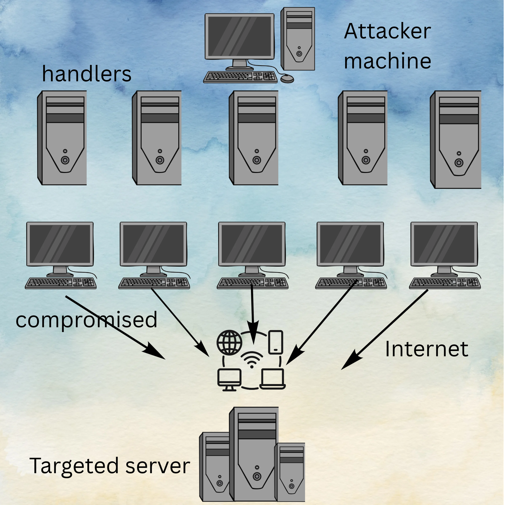

# Ethical vs Illegal Hacking

## Ethical Hacking

Ethical hacking is a type of hacking that is done with permission to find and fix security flaws. Without ethical hackers constantly testing and fixing flaws behind the scenes, your personal identity, finances, and privacy would be exposed to non-stop cyber-attacks. Ethical hackers help everyone be more secure when using technology and make it harder for illegal hackers to find vulnerabilities in a system. 

## Illegal Hacking

Illegal hacking is a type of hacking done without permission usually for nefarious purposes. The consequences of this can range from identity theft to stolen finances to exploitation in various forms. Illegal hacking, compared to ethical hacking, is purely destructive.

# DoS/DDoS Attacks

## Description

Denial of Service/Distributed Denial of Service (DoS/DDoS) attacks are a kind of cyber attack that causes any sort of online service (like a login page for example) to effectively shut down for a certain amount of time.

## How It Works

DoS/DDoS attacks work by flooding a service with requests, overloading the system and causing it to become unresponsive. Think of it like people crowding the entrance of a restaurant, preventing legitimate customers from getting inside.

## Examples in the Real World

'Anonymous' is a decentralized international group of hackers known for performing cyberattacks on governments, corporations, and the Church of Scientology.\
\
Anonymous first became associated with hacktivism in 2008 following a series of actions against the Church of Scientology known as Project Chanology. On January 15, 2008, the gossip blog Gawker posted a video in which celebrity Scientologist Tom Cruise praised the religion; and the Church responded with a cease-and-desist letter for violation of copyright. 4chan users organized a raid against the Church in retaliation, prank-calling its hotline, sending black faxes designed to waste ink cartridges, and launching DDoS attacks against its websites.\
\
The DDoS attacks were at first carried out with the Gigaloader and JMeter applications. Within a few days, these were supplanted by the Low Orbit Ion Cannon (LOIC), a network stress-testing application allowing users to flood a server with TCP or UDP packets. The LOIC soon became a signature weapon in the Anonymous arsenal; however, it would also lead to a number of arrests of less experienced Anons who failed to conceal their IP addresses.\
\
\
sources:\
https://en.wikipedia.org/wiki/Denial-of-service_attack
https://en.wikipedia.org/wiki/Anonymous_(hacker_group)
